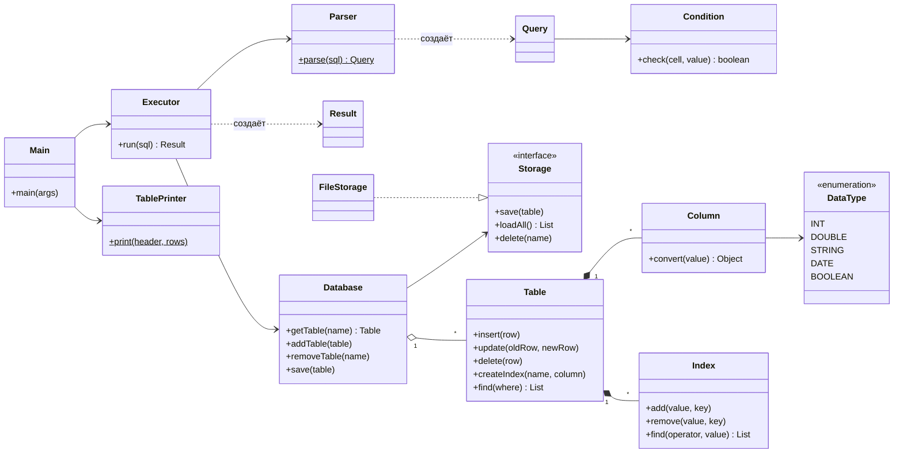
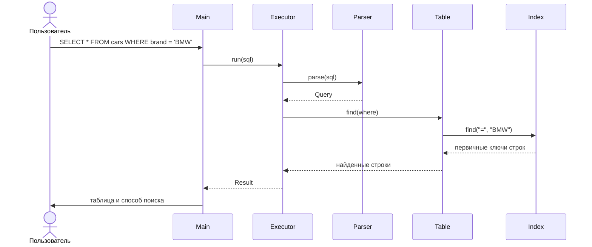
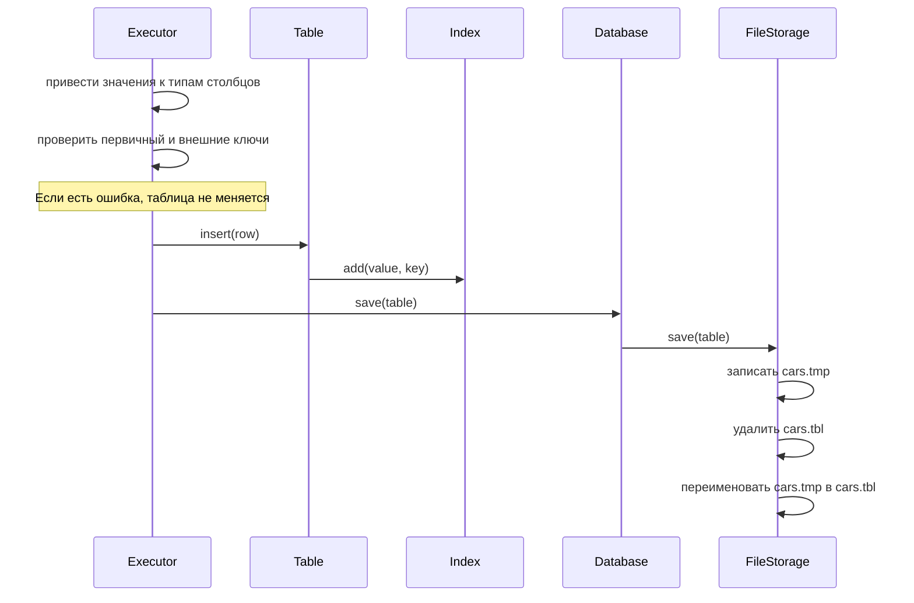

# MiniDB — упрощённая СУБД на Java

Лабораторная работа 2. Программа хранит таблицы в файлах на диске и выполняет SQL-подобные запросы
из консоли. Внешних библиотек нет, код совместим с Java 8 и использует материал лекций курса.

**Предметная область:** автосалон. Таблица `sales` (продажи) ссылается на таблицу `cars` (автомобили)
по ключу `sales.car_id → cars.id` (см. [demo.sql](demo.sql)).

## Что умеет программа

| Требование | Как сделано |
|---|---|
| Две таблицы, связанные по ключу | `PRIMARY KEY` и `REFERENCES`. Нельзя добавить продажу несуществующего автомобиля и нельзя удалить автомобиль, у которого есть продажи |
| Типы данных | `INT`, `DOUBLE`, `STRING`, `DATE`, `BOOLEAN` |
| Хранение на диске | Сериализация Java, отдельный файл на таблицу, загрузка при запуске |
| Вставка с проверкой первичного ключа | `INSERT`, одна или несколько записей. При ошибке не вставляется ни одна |
| Обновление и удаление по условию | `UPDATE ... WHERE`, `DELETE ... WHERE` |
| Вывод в виде таблицы | Класс `TablePrinter` |
| SQL-подобный язык | `SELECT`, `INSERT`, `UPDATE`, `DELETE`, `CREATE TABLE`, `DROP TABLE`, `CREATE INDEX` |
| Индексы | Хранятся на диске вместе с таблицей и восстанавливаются при запуске. `SELECT`, `UPDATE` и `DELETE` используют их, если условие задано по индексированному столбцу |
| Восстановление после сбоя | Запись через временный файл, разбор оставшихся файлов при запуске |

Ограничения (задание гарантирует запросы простого формата):

* в `WHERE` одно условие вида `столбец оператор значение`; операторы: `=`, `!=`, `<>`, `<`, `<=`, `>`, `>=`;
* первичный ключ состоит из одного столбца, изменять его через `UPDATE` нельзя;
* в `UPDATE` и `INSERT` используются только готовые значения, без выражений вроде `price * 2`;
* в столбце `INT` условие сравнивается только с целым числом;
* запрос должен заканчиваться `;` в конце строки, на одной строке — один запрос;
* защищена запись от падения программы, но не от отключения питания: данные не принудительно сбрасываются на диск.

## Инструкция пользователя

### Сборка и запуск

Нужен JDK 8 или новее. Если `javac` нет в `PATH`, укажите путь к JDK в `JAVA_HOME`, например JDK из IntelliJ IDEA:

```bash
set JAVA_HOME=C:\Program Files\JetBrains\IntelliJ IDEA 2026.2.3\jbr
```

Сборка:

```bash
build.bat
```

Запуск консоли (выход — команда `exit`):

```bash
run.bat
```

Запуск всех запросов из файла:

```bash
run.bat demo.sql
```

Без `.bat`-файлов то же самое делается так:

```bash
javac -encoding UTF-8 -d out src/*.java
```

```bash
java -cp out Main
```

`run.bat` включает кодировку консоли 866, чтобы русский текст работал при вводе и выводе. Данные лежат в папке `data`. Сценарий `demo.sql` сначала удаляет таблицы `cars` и `sales`, если они уже есть.

### Примеры команд

```sql
CREATE TABLE cars (id INT PRIMARY KEY, brand STRING, price DOUBLE, available BOOLEAN);
CREATE TABLE sales (id INT PRIMARY KEY, car_id INT REFERENCES cars(id), customer STRING, sale_date DATE);

INSERT INTO cars VALUES (1, 'Toyota', 25000.0, TRUE);
INSERT INTO cars (id, brand) VALUES (2, 'BMW');
INSERT INTO cars VALUES (3, 'Lada', 9000.5, TRUE), (4, 'Audi', 35000, TRUE);
INSERT INTO sales VALUES (1, 1, 'Иванов', '2024-03-15');

SELECT * FROM cars;
SELECT brand, price FROM cars WHERE price > 20000;
SELECT * FROM sales WHERE sale_date >= '2024-01-01';

UPDATE cars SET price = 30000 WHERE id = 2;
DELETE FROM sales WHERE car_id = 1;
DELETE FROM cars WHERE brand = 'Toyota';

CREATE INDEX idx_cars_brand ON cars (brand);
SELECT * FROM cars WHERE brand = 'BMW';

DROP TABLE sales;
DROP TABLE IF EXISTS sales;
```

Значения записываются так: `42`, `9000.5`, `'строка'`, `'O''Brien'` (кавычка внутри строки удваивается),
`TRUE`, `FALSE`, `NULL`; дата — строка `'ГГГГ-ММ-ДД'`.

Пример работы:

```
minidb> SELECT * FROM cars WHERE brand = 'BMW';
+----+-------+---------+-----------+
| id | brand | price   | available |
+----+-------+---------+-----------+
| 2  | BMW   | 30000.0 | NULL      |
+----+-------+---------+-----------+
1 row(s), 0,151 ms, search: index idx_cars_brand

minidb> DELETE FROM cars WHERE brand = 'Toyota';
ERROR: Row with key 1 is used in table sales
```

Строка `search` показывает способ поиска: `primary key`, `index имя_индекса` или `full scan` (просмотр всей таблицы).

## Архитектура системы

Все классы лежат в одной папке `src`:

| Класс | Что делает |
|---|---|
| `Main` | Консоль: читает запросы и печатает ответы |
| `Parser` | Разбирает текст запроса и создаёт объект `Query` |
| `Query`, `Condition` | Разобранный запрос и его условие `WHERE` |
| `Executor` | Выполняет запрос и возвращает `Result` |
| `Result`, `TablePrinter` | Результат запроса и его вывод в виде таблицы |
| `Database` | Все таблицы базы (паттерн Repository) |
| `Table`, `Column`, `DataType` | Таблица, её столбцы и их типы |
| `Index` | Индекс по столбцу на основе `TreeMap` |
| `Storage`, `FileStorage` | Интерфейс хранилища и его реализация на файлах (паттерн DAO) |
| `DbException` | Ошибка, которую видит пользователь |
| `Tests`, `Benchmark` | Автоматические тесты и замер скорости |

Классы и основные методы описаны короткими комментариями Javadoc. Простые геттеры, сеттеры и конструкторы
без особой логики обычно не описаны: их назначение понятно из названия. Документация создаётся командой:

```bash
javadoc -encoding UTF-8 -charset UTF-8 -d docs src/*.java
```

Использованные паттерны:

* **DAO** — `Storage`: остальной код не знает, как устроены файлы;
* **Repository** — `Database`: работа с таблицами как с коллекцией объектов;
* **Iterator** — `Table implements Iterable`: строки обходятся циклом `for (Object[] row : table)`.

### Диаграмма классов



### Диаграмма последовательности: SELECT по индексу



### Диаграмма последовательности: INSERT и сохранение на диск



### Хранение и восстановление после сбоя

Каждая таблица вместе с индексами сериализуется в один файл `data/имя_таблицы.tbl`, поэтому индекс не может
разойтись с данными. Таблица сохраняется целиком после каждого изменения: сначала во временный файл `.tmp`,
затем он заменяет основной. При запуске `FileStorage` смотрит, что осталось в папке:

| Что найдено | Что произошло | Что делает программа |
|---|---|---|
| `.tmp` и `.tbl` | Сбой во время записи `.tmp` | Удаляет `.tmp`, остаётся последняя целая версия |
| Только `.tmp` | Сбой между удалением `.tbl` и переименованием | Переименовывает `.tmp` в `.tbl` |
| Испорченный `.tbl` | Файл повреждён | Переименовывает его в `.bad`, остальные таблицы работают |

### Индекс

`Index` хранит `TreeMap<значение столбца, список первичных ключей>`. `TreeMap` держит ключи отсортированными
и находит нужный ключ за O(log n):

| Условие | Метод |
|---|---|
| `=` | `get(value)` |
| `>=`, `>` | `tailMap(value)` |
| `<`, `<=` | `headMap(value)` |

Способ поиска выбирается в `Table.find`:

1. `=` по первичному ключу — поиск в `LinkedHashMap`;
2. условие по столбцу с индексом — поиск через `Index` (кроме `!=`, при котором подходят почти все строки);
3. иначе — просмотр всей таблицы.

### Что из лекций использовано

| Лекция | Где в программе |
|---|---|
| 2. Синтаксис | `switch` по строкам, массивы (строка таблицы — `Object[]`), циклы |
| 3. Классы | `private`-поля с геттерами, `final`, интерфейс `Storage`, `enum DataType` |
| 4. Исключения | `DbException extends RuntimeException`, `throw`, `try-catch`, `catch (Exception e)` последним, try-with-resources |
| 5. Ввод-вывод | `Scanner`, `File`, `InputStreamReader`, `ObjectOutputStream`, `ObjectInputStream`, `Serializable`, `serialVersionUID` |
| 6. Библиотека | Методы `String`, `StringBuilder`, классы-оболочки, `printf`, `Math.max`, `Random` |
| 7. Параметризация | `List<Object[]>`, `Map<String, Table>` и другие параметризованные типы |
| 8. Коллекции | `ArrayList`, `HashMap`, `HashSet`, `TreeMap`, `SortedMap`, `Iterable`, for-each |

Вне лекций использованы `LocalDate` (самый простой способ хранить дату), `LinkedHashMap` (та же `Map`, но помнит порядок вставки) и `Buffered*Stream` (ускоряют чтение и запись файлов).

## Тестирование

### Автоматические тесты

```bash
java -cp out Tests
```

Класс [`Tests`](src/Tests.java) проверяет первичный ключ, типы, `SELECT`, `UPDATE`, `DELETE`, внешние ключи,
создание и удаление таблиц, выбор индекса, сохранение на диск и три вида сбоев. Отдельный тест сравнивает на случайных
данных результаты запросов с индексом и без него, в том числе после `UPDATE` и `DELETE`. Результат: `All tests passed`.

### Производительность: с индексом и без

```bash
java -Xmx4g -cp out Benchmark
```

Таблица `items(id, category, price, created, active)` заполнена случайными данными: 1000 категорий, цены от 0 до 100 000.
Каждый запрос выполнялся 5 раз для разогрева и 20 раз для замера, в таблицах указана медиана. Тест также проверяет,
что с индексом и без него находится одинаковое число строк. Окружение: Java 25, Windows 11, 16 логических ядер.
Запуск один, поэтому значения ориентировочные и зависят от компьютера.

**10 000 строк**

| Запрос (`WHERE`) | Найдено строк | Без индекса, мс | С индексом, мс |
|---|---:|---:|---:|
| `category = 'cat_500'` | 10 | 0,295 | 0,024 |
| `price > 99900` | 15 | 0,341 | 0,062 |
| `price > 99000` | 114 | 0,255 | 0,080 |
| `price < 20000` | 2 042 | 0,491 | 0,790 |

**100 000 строк**

| Запрос (`WHERE`) | Найдено строк | Без индекса, мс | С индексом, мс |
|---|---:|---:|---:|
| `category = 'cat_500'` | 102 | 2,473 | 0,028 |
| `price > 99900` | 121 | 3,464 | 0,099 |
| `price > 99000` | 1 040 | 2,359 | 0,617 |
| `price < 20000` | 20 246 | 4,938 | 3,976 |

**1 000 000 строк**

| Запрос (`WHERE`) | Найдено строк | Без индекса, мс | С индексом, мс |
|---|---:|---:|---:|
| `category = 'cat_500'` | 999 | 71,648 | 0,297 |
| `price > 99900` | 1 008 | 47,123 | 0,574 |
| `price > 99000` | 10 044 | 46,935 | 9,811 |
| `price < 20000` | 200 406 | 93,445 | 169,882 |

**Затраты на хранение и индексы**

| Операция | 10 000 строк | 100 000 строк | 1 000 000 строк |
|---|---:|---:|---:|
| Сохранение таблицы без индексов | 93 мс | 234 мс | 9 123 мс |
| `CREATE INDEX` по `category`, включая сохранение | 70 мс | 315 мс | 10 661 мс |
| `CREATE INDEX` по `price`, включая сохранение | 66 мс | 707 мс | 19 220 мс |
| Загрузка таблицы с двумя индексами | 139 мс | 284 мс | 7 241 мс |
| Размер файла с двумя индексами | 1,0 МБ | 10,1 МБ | 100,0 МБ |

## Распределение работы в команде

> Заполните перед сдачей (не более 3 участников).

| Участник | Область ответственности |
|---|---|
| _ФИО 1_ | `Table`, `Column`, `FileStorage`, сериализация и восстановление |
| _ФИО 2_ | `Parser`, `Executor`, консоль |
| _ФИО 3_ | `Index`, тесты, замеры, readme |

## Выводы

1. Создана упрощённая СУБД на Java: таблицы, связанные по ключу, пять типов данных, SQL-подобный язык и консольный интерфейс.
2. Данные сохраняются сериализацией и загружаются при запуске. Запись через временный файл позволяет пережить падение программы во время сохранения.
3. Индекс на `TreeMap` заметно ускоряет поиск, когда условию подходит малая часть строк: на 1 000 000 строк поиск примерно 0,1% строк ускорился в 80–240 раз, а 1% — примерно в 5 раз.
4. Когда условию подходит много строк (около 20%), индекс бесполезен: на 10 000 и 1 000 000 строк запрос с ним оказался медленнее, потому что для каждой найденной строки выполняется отдельный поиск по первичному ключу.
5. Индекс требует затрат: файл и время загрузки растут, а каждое изменение данных обновляет ещё и индекс.
6. Сохранение всей таблицы после каждого изменения — простое решение, но на больших таблицах оно занимает секунды. Это главное ограничение программы.

## Список использованных источников

1. Лекции курса «Программирование на языке Java»: 1. Введение; 2. Синтаксис; 3. Классы и интерфейсы; 4. Обработка исключений; 5. Консольный ввод-вывод; 6. Стандартная библиотека; 7. Параметризация типов; 8. Коллекции.
2. Java SE 8 API Documentation. — Oracle. — https://docs.oracle.com/javase/8/docs/api/
3. Java Object Serialization Specification. — Oracle. — https://docs.oracle.com/javase/8/docs/platform/serialization/spec/serialTOC.html
