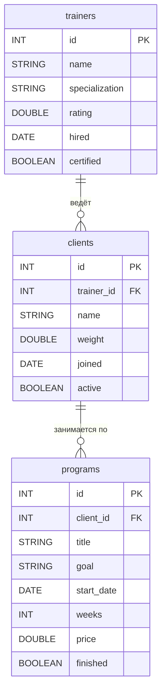
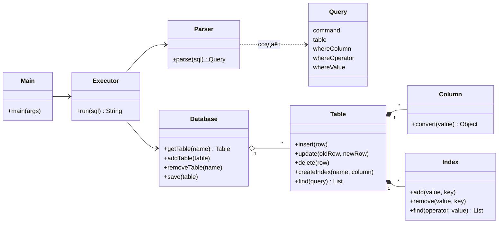
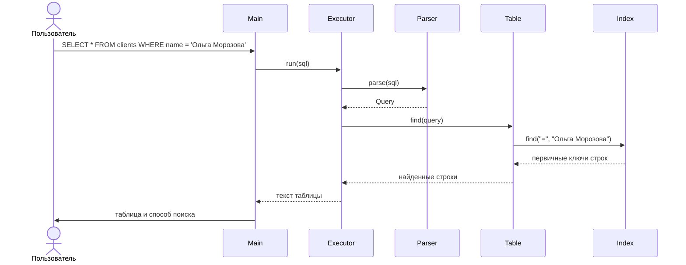
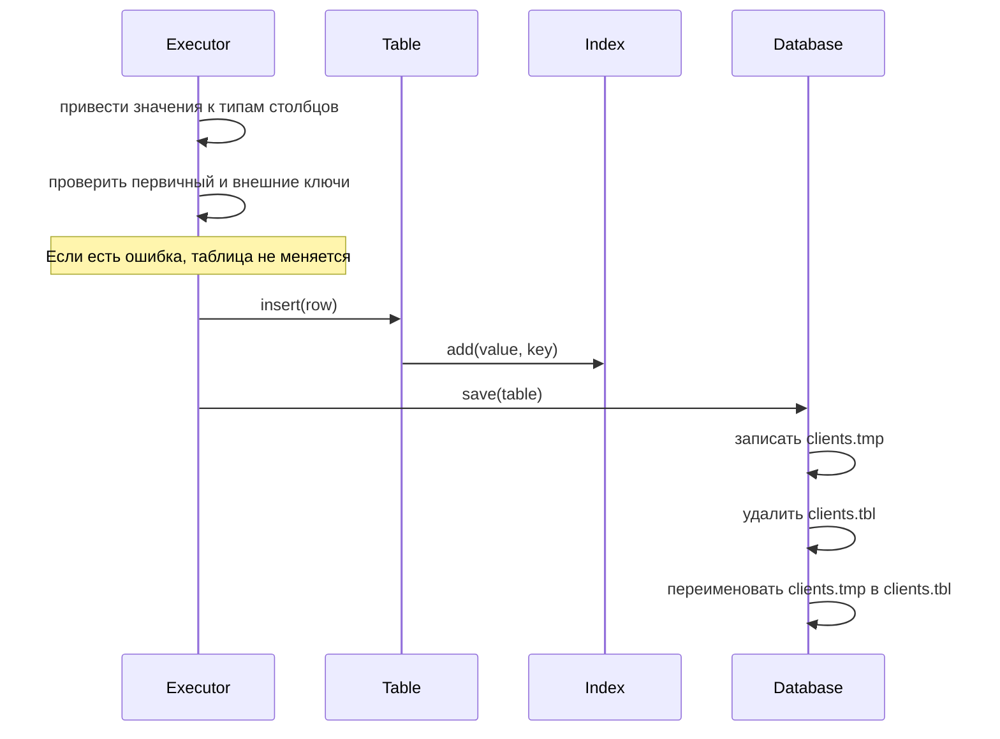

# GymDB — упрощённая СУБД на Java

Лабораторная работа 2. Программа хранит таблицы в файлах на диске и выполняет SQL-подобные запросы,
которые пользователь вводит в консоли. Внешних библиотек нет, код совместим с Java 8.

**Выполнили:** студенты группы 25КНТ-6 Лебедев Сергей Александрович и Копейкин Александр Александрович.

## Предметная область

Предметная область — тренажёрный зал (фитнес-клуб). В зале работают персональные тренеры разных направлений:
силовые тренировки, йога, кроссфит. За каждым клиентом закреплён один тренер, а у тренера может быть много клиентов.
Тренер составляет для своего клиента программы тренировок: например, «Силовой старт» на 12 недель для набора массы.
Когда одна программа заканчивается, клиент может перейти на следующую, поэтому у клиента может быть несколько программ.

Пользователь системы — администратор зала. С помощью базы данных он:

* ведёт список тренеров: специализация, рейтинг по отзывам клиентов, дата приёма на работу, наличие сертификата;
* ведёт список клиентов: к какому тренеру прикреплён, вес, дата первого посещения, действует ли абонемент;
* хранит программы тренировок клиентов: название, цель, дата начала, длительность в неделях, стоимость, завершена ли;
* отвечает на вопросы вида «какие клиенты у тренера Петрова», «какие программы у клиента Орлова»,
  «какие тренеры имеют рейтинг выше 4.5», «какие программы ещё не завершены»;
* меняет данные: переводит клиента к другому тренеру, отмечает программу завершённой, обновляет рейтинг тренера;
* удаляет клиентов с закончившимся абонементом и их программы.

Правила предметной области, которые соблюдает база:

* у каждого тренера, клиента и программы свой уникальный номер `id`;
* клиента нельзя прикрепить к тренеру, которого нет в базе, а программу нельзя создать для несуществующего клиента;
* нельзя удалить тренера, пока у него есть клиенты, и нельзя удалить клиента, пока у него есть программы:
  сначала клиентов нужно перевести к другому тренеру, а программы удалить.

База состоит из трёх таблиц:

**`trainers` — тренеры**

| Столбец | Тип | Смысл |
|---|---|---|
| `id` | `INT`, первичный ключ | номер тренера |
| `name` | `STRING` | имя и фамилия |
| `specialization` | `STRING` | направление: силовые, йога, кроссфит |
| `rating` | `DOUBLE` | рейтинг по отзывам, от 0 до 5 |
| `hired` | `DATE` | дата приёма на работу |
| `certified` | `BOOLEAN` | есть ли сертификат |

**`clients` — клиенты**

| Столбец | Тип | Смысл |
|---|---|---|
| `id` | `INT`, первичный ключ | номер клиента |
| `trainer_id` | `INT`, ссылка на `trainers(id)` | личный тренер клиента |
| `name` | `STRING` | имя и фамилия |
| `weight` | `DOUBLE` | вес, кг |
| `joined` | `DATE` | дата первого посещения |
| `active` | `BOOLEAN` | действует ли абонемент |

**`programs` — программы тренировок**

| Столбец | Тип | Смысл |
|---|---|---|
| `id` | `INT`, первичный ключ | номер программы |
| `client_id` | `INT`, ссылка на `clients(id)` | для какого клиента |
| `title` | `STRING` | название: «Силовой старт», «Стройность» |
| `goal` | `STRING` | цель: набор массы, похудение, растяжка, выносливость |
| `start_date` | `DATE` | дата начала |
| `weeks` | `INT` | длительность, недель |
| `price` | `DOUBLE` | стоимость, руб. |
| `finished` | `BOOLEAN` | завершена ли программа |

Связи один-ко-многим образуют цепочку: тренер → клиенты → программы тренировок.

Схема связей ниже — ER-диаграмма (сущность — связь). Этот вид диаграмм, как и диаграммы классов и
последовательностей из раздела «Архитектура системы», мы разбирали на курсе «Управление данными».



Программа следит за связями при `INSERT`, `UPDATE`, `DELETE` и `DROP TABLE`: нельзя сослаться на несуществующую
запись и нельзя удалить запись или таблицу, на которую ссылаются.

## Что умеет программа

| Требование | Как сделано |
|---|---|
| Таблицы, связанные по ключу | Три таблицы, `PRIMARY KEY` и `REFERENCES`. Внешние ключи проверяются при `INSERT`, `UPDATE`, `DELETE` и `DROP TABLE` |
| Типы данных | `INT`, `DOUBLE`, `STRING`, `DATE`, `BOOLEAN` |
| Хранение на диске | Сериализация Java, отдельный файл на таблицу, загрузка при запуске |
| Вставка с проверкой первичного ключа | `INSERT`, одна или несколько записей. При ошибке не вставляется ни одна |
| Обновление и удаление по условию | `UPDATE ... WHERE`, `DELETE ... WHERE` |
| Вывод в виде таблицы | `SELECT` печатает результат в рамке из `+`, `-`, `|` |
| SQL-подобный язык | `SELECT`, `INSERT`, `UPDATE`, `DELETE`, `CREATE TABLE`, `DROP TABLE`, `CREATE INDEX` |
| Индексы | Хранятся на диске вместе с таблицей и восстанавливаются при запуске. `SELECT`, `UPDATE` и `DELETE` используют их, если условие по индексированному столбцу |
| Восстановление после сбоя | Запись через временный файл, разбор оставшихся файлов при запуске |

Ограничения (задание гарантирует запросы простого формата):

* в `WHERE` одно условие вида `столбец оператор значение`; операторы: `=`, `!=`, `<>`, `<`, `<=`, `>`, `>=`;
* первичный ключ — один столбец, менять его через `UPDATE` нельзя;
* в `INSERT` и `UPDATE` только готовые значения, без выражений;
* каждый запрос заканчивается `;`; запрос может занимать несколько строк, а в одной строке может быть несколько запросов.

## Инструкция пользователя

### Запуск в IntelliJ IDEA

Откройте папку проекта. В списке конфигураций вверху есть:

* **Main** — консоль, в которой вы сами вводите запросы;
* **Main tests.sql** — выполнить все проверочные запросы из файла [tests.sql](tests.sql);
* **Benchmark** — замер скорости с индексом и без.

### Запуск из командной строки

Нужен JDK 8 или новее.

```bash
build.bat
```

```bash
run.bat
```

```bash
run.bat tests.sql
```

Без `.bat`-файлов:

```bash
javac -encoding UTF-8 -d out src/*.java
```

```bash
java -cp out Main
```

Данные лежат в папке `data`. Выход из консоли — `exit` или `выход`.

### Примеры команд

```sql
CREATE TABLE trainers (id INT PRIMARY KEY, name STRING, specialization STRING, rating DOUBLE, hired DATE, certified BOOLEAN);
CREATE TABLE clients (id INT PRIMARY KEY, trainer_id INT REFERENCES trainers(id), name STRING, weight DOUBLE, joined DATE, active BOOLEAN);
CREATE TABLE programs (id INT PRIMARY KEY, client_id INT REFERENCES clients(id), title STRING, goal STRING, start_date DATE, weeks INT, price DOUBLE, finished BOOLEAN);

INSERT INTO trainers VALUES (1, 'Иван Петров', 'силовые', 4.8, '2021-09-01', TRUE);
INSERT INTO trainers (id, name) VALUES (2, 'Анна Смирнова');
INSERT INTO clients VALUES (1, 1, 'Дмитрий Орлов', 92.5, '2024-01-10', TRUE), (2, 1, 'Елена Волкова', 61.0, '2024-02-05', TRUE);
INSERT INTO programs VALUES (1, 1, 'Силовой старт', 'набор массы', '2024-01-15', 12, 15000.0, FALSE);

SELECT * FROM trainers;
SELECT name FROM clients WHERE trainer_id = 1;
SELECT title, goal FROM programs WHERE start_date >= '2024-01-01';

UPDATE trainers SET specialization = 'йога', rating = 4.9 WHERE id = 2;
UPDATE clients SET trainer_id = 2 WHERE id = 2;
UPDATE programs SET finished = TRUE WHERE id = 1;
DELETE FROM programs WHERE finished = TRUE;

CREATE INDEX idx_clients_trainer ON clients (trainer_id);
SELECT name FROM clients WHERE trainer_id = 1;

DROP TABLE programs;
DROP TABLE IF EXISTS programs;
```

Значения: `42`, `82.5`, `'строка'`, `'O''Brien'` (кавычка внутри строки удваивается), `TRUE`, `FALSE`, `NULL`;
дата — строка `'ГГГГ-ММ-ДД'`.

Пример работы:

```
gym> SELECT name FROM clients WHERE trainer_id = 1;
+---------------+
| name          |
+---------------+
| Дмитрий Орлов |
| Елена Волкова |
+---------------+
Строк: 2, поиск: индекс idx_clients_trainer
Время: 0,172 мс

gym> DELETE FROM trainers WHERE id = 1;
ОШИБКА: Строка с ключом 1 используется в таблице clients
```

Строка `поиск` показывает, как найдены строки: `первичный ключ`, `индекс имя_индекса` или `полный просмотр`.

## Архитектура системы

| Класс | Что делает |
|---|---|
| `Main` | Консоль: читает запросы с клавиатуры или из файла и печатает ответы |
| `Parser` | Разбивает текст запроса на слова и заполняет объект `Query` |
| `Query` | Разобранный запрос: команда, таблица, столбцы, значения, условие `WHERE` |
| `Executor` | Выполняет запрос, проверяет ключи и печатает результат в виде таблицы |
| `Database` | Все таблицы базы, их сохранение в файлы и загрузка при запуске |
| `Table` | Строки таблицы, индексы, поиск строк по условию |
| `Column` | Имя, тип столбца и приведение значения к этому типу |
| `Index` | Индекс по столбцу на основе `TreeMap` |
| `Benchmark` | Замер скорости поиска с индексом и без |

Использованные паттерны:

* **Repository / DAO** — `Database`: остальной код работает с таблицами как с коллекцией и не знает, как устроены файлы;
* **Iterator** — `Table implements Iterable`: строки обходятся циклом `for (Object[] row : table)`.

Все диаграммы в этом отчёте — ER-диаграмма, диаграмма классов и диаграммы последовательностей — построены
по нотации, которую мы разбирали на курсе «Управление данными».

### Диаграмма классов



### Диаграмма последовательности: SELECT по индексу



### Диаграмма последовательности: INSERT и сохранение на диск



### Хранение и восстановление после сбоя

Каждая таблица вместе с индексами сериализуется в один файл `data/имя_таблицы.tbl`, поэтому индекс не может
разойтись с данными. После каждого изменения таблица записывается во временный файл `.tmp`, который затем заменяет
основной. При запуске `Database` смотрит, что осталось в папке:

| Что найдено | Что произошло | Что делает программа |
|---|---|---|
| `.tmp` и `.tbl` | Сбой во время записи `.tmp` | Удаляет `.tmp`, остаётся последняя целая версия |
| Только `.tmp` | Сбой между удалением `.tbl` и переименованием | Переименовывает `.tmp` в `.tbl` |
| Испорченный `.tbl` | Файл повреждён | Переименовывает его в `.bad`, остальные таблицы работают |

### Индекс

`Index` хранит `TreeMap<значение столбца, список первичных ключей>`. `TreeMap` — красно-чёрное дерево: ключи
отсортированы, поиск занимает O(log n).

| Условие | Метод `TreeMap` |
|---|---|
| `=` | `subMap(value, true, value, true)` |
| `>`, `>=` | `tailMap(value, false / true)` |
| `<`, `<=` | `headMap(value, false / true)` |

Способ поиска выбирается в `Table.searchMethod`:

1. `=` по первичному ключу — поиск в `LinkedHashMap` строк;
2. условие по столбцу с индексом (кроме `!=`) — поиск через `Index`;
3. иначе — просмотр всей таблицы.

## Тестирование

### Проверочные запросы

Файл [tests.sql](tests.sql) по шагам проверяет создание таблиц, все типы данных, вставку одной и нескольких записей,
повтор первичного ключа, ошибки типов, `SELECT` с условиями по каждому типу, оба внешних ключа, `UPDATE`, `DELETE`, индексы, `DROP TABLE`
и ошибки в запросах. Перед каждым шагом в комментарии написано, какой результат ожидается.

```bash
run.bat tests.sql
```

### Производительность: с индексом и без

```bash
java -Xmx4g -cp out Benchmark
```

Для замера используется отдельная таблица посещений `visits(id, exercise, weight, day, done)` со случайными данными:
1000 разных упражнений, рабочий вес от 0 до 1000.
Замеряется поиск строк (`Table.find`): 5 запусков для разогрева и 20 для замера, в таблице медиана. Программа также
проверяет, что с индексом и без находится одинаковое число строк. Окружение: Java 25, Windows 11.

**10 000 строк**

| Запрос (`WHERE`) | Найдено строк | Без индекса, мс | С индексом, мс |
|---|---:|---:|---:|
| `exercise = 'ex_500'` | 9 | 0,436 | 0,012 |
| `weight > 999` | 10 | 0,239 | 0,023 |
| `weight > 990` | 110 | 0,230 | 0,037 |
| `weight < 200` | 1 996 | 0,505 | 0,582 |

**100 000 строк**

| Запрос (`WHERE`) | Найдено строк | Без индекса, мс | С индексом, мс |
|---|---:|---:|---:|
| `exercise = 'ex_500'` | 108 | 1,798 | 0,007 |
| `weight > 999` | 90 | 1,121 | 0,010 |
| `weight > 990` | 965 | 1,274 | 0,046 |
| `weight < 200` | 20 024 | 1,639 | 2,276 |

**1 000 000 строк**

| Запрос (`WHERE`) | Найдено строк | Без индекса, мс | С индексом, мс |
|---|---:|---:|---:|
| `exercise = 'ex_500'` | 1 039 | 17,370 | 0,017 |
| `weight > 999` | 1 003 | 13,493 | 0,033 |
| `weight > 990` | 10 012 | 14,134 | 0,551 |
| `weight < 200` | 200 132 | 17,248 | 26,499 |

**Затраты на хранение и индексы**

| Операция | 10 000 строк | 100 000 строк | 1 000 000 строк |
|---|---:|---:|---:|
| Сохранение таблицы без индексов | 86 мс | 152 мс | 4 492 мс |
| `CREATE INDEX` по `exercise`, включая сохранение | 40 мс | 188 мс | 5 323 мс |
| `CREATE INDEX` по `weight`, включая сохранение | 54 мс | 337 мс | 7 610 мс |
| Загрузка таблицы с двумя индексами | 109 мс | 225 мс | 1 585 мс |
| Размер файла с двумя индексами | 1,0 МБ | 9,3 МБ | 81,2 МБ |

## Распределение работы в команде

| Участник | Область ответственности |
|---|---|
| Лебедев Сергей Александрович, 25КНТ-6 | `Parser`, `Query`, `Executor`, `Main`: разбор и выполнение запросов, консоль |
| Копейкин Александр Александрович, 25КНТ-6 | `Database`, `Table`, `Column`, `Index`, `Benchmark`: хранение, индексы, замеры, readme |

## Выводы

1. Создана упрощённая СУБД на Java для тренажёрного зала: три связанные по ключу таблицы (тренеры, клиенты, программы тренировок), пять типов данных, SQL-подобный язык и консольный ввод запросов.
2. Данные сохраняются сериализацией и загружаются при запуске. Запись через временный файл позволяет пережить падение программы во время сохранения.
3. Индекс на `TreeMap` сильно ускоряет поиск, когда условию подходит малая часть строк: на 1 000 000 строк поиск 0,1% строк ускорился примерно в 400–1000 раз, а 1% — примерно в 25 раз.
4. Когда условию подходит много строк (около 20%), индекс не помогает и даже замедляет поиск: для каждой найденной строки выполняется отдельный поиск по первичному ключу.
5. Индекс требует затрат: файл и время загрузки растут, а каждое изменение данных обновляет и индекс.
6. Сохранение всей таблицы после каждого изменения — простое решение, но на больших таблицах оно занимает секунды. Это главное ограничение программы.

## Список использованных источников

1. Лекции курса «Программирование на языке Java».
2. Лекции курса «Управление данными»: ER-диаграммы, диаграммы классов и последовательностей.
3. Java SE 8 API Documentation. — Oracle. — https://docs.oracle.com/javase/8/docs/api/
4. Java Object Serialization Specification. — Oracle. — https://docs.oracle.com/javase/8/docs/platform/serialization/spec/serialTOC.html
5. Кормен Т., Лейзерсон Ч., Ривест Р., Штайн К. Алгоритмы: построение и анализ. — Глава 13 «Красно-чёрные деревья».
