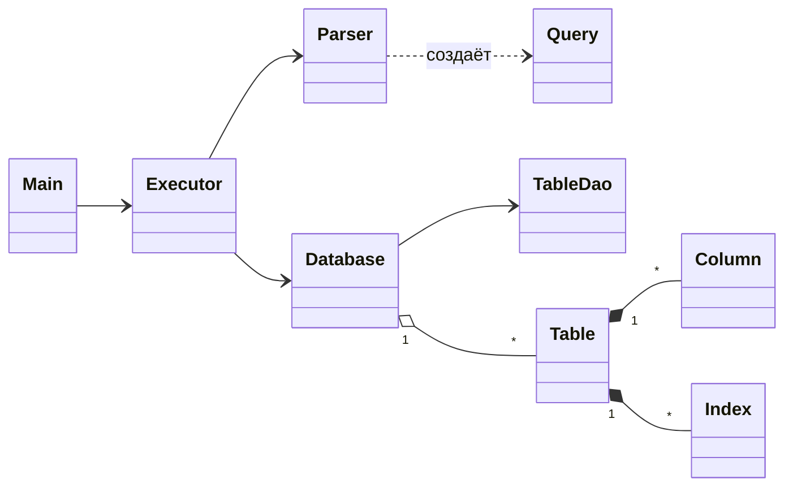
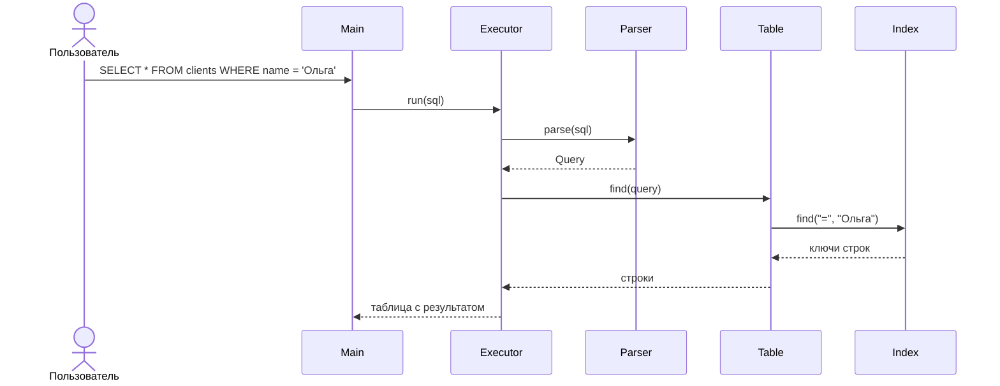
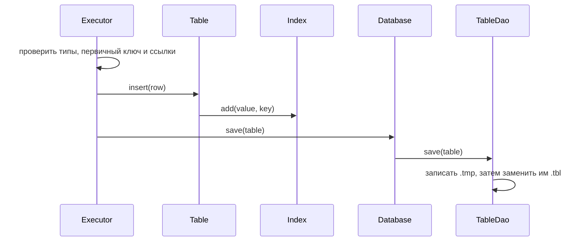

# GymDB — простая база данных на Java

Лабораторная работа 2. Программа хранит таблицы в файлах и выполняет SQL-подобные команды из консоли.
Нужна только Java 8 или новее.

**Выполнили:** Лебедев Сергей Александрович и Копейкин Александр Александрович, группа 25КНТ-6.

## Предметная область

Тренажёрный зал: у тренера есть клиенты, у клиента — программы тренировок. Три таблицы связаны по ключу:

| Таблица | Столбцы |
|---|---|
| `trainers` — тренеры | `id` (ключ), `name`, `specialization`, `rating`, `hired`, `certified` |
| `clients` — клиенты | `id` (ключ), `trainer_id` → `trainers.id`, `name`, `weight`, `joined`, `active` |
| `programs` — программы | `id` (ключ), `client_id` → `clients.id`, `title`, `goal`, `start_date`, `weeks`, `price`, `finished` |

Нельзя добавить клиента к несуществующему тренеру и нельзя удалить тренера, у которого есть клиенты.
Для программ и клиентов действуют те же правила.

## Возможности

* Типы данных: `INT`, `DOUBLE`, `STRING`, `DATE` (`'2024-05-01'`), `BOOLEAN` (`TRUE`/`FALSE`).
* Команды: `CREATE TABLE`, `DROP TABLE`, `INSERT`, `SELECT`, `UPDATE`, `DELETE`, `CREATE INDEX`.
* `INSERT` одной или нескольких строк с проверкой первичного ключа: при повторе не вставляется ничего.
* `SELECT` выводит результат таблицей в рамке.
* Таблицы и индексы сохраняются в файлы и загружаются при запуске.
* `SELECT`, `UPDATE` и `DELETE` используют индекс, если условие задано по индексированному столбцу.
* Если программа упадёт во время записи, данные не испортятся.

Ограничения: в `WHERE` одно условие (`=`, `!=`, `<`, `<=`, `>`, `>=`), первичный ключ изменять нельзя.

## Инструкция пользователя

Нужен JDK 8+. Если `javac` нет в `PATH`, укажите путь к JDK в переменной `JAVA_HOME`.

* `build.bat` — собрать программу;
* `run.bat` — открыть консоль (выход — `exit`);
* `run.bat tests.sql` — выполнить все проверки из [tests.sql](tests.sql);
* `java -cp out Benchmark` — замер скорости.

В IntelliJ IDEA пометьте папку `src` как Sources Root и запустите класс `Main`. Для проверок укажите в настройках
запуска аргумент `tests.sql`, а рабочей папкой — папку проекта.

Каждая команда заканчивается `;`, строки пишутся в одинарных кавычках. Примеры:

```sql
CREATE TABLE trainers (id INT PRIMARY KEY, name STRING, rating DOUBLE, hired DATE, certified BOOLEAN);
CREATE TABLE clients (id INT PRIMARY KEY, trainer_id INT REFERENCES trainers(id), name STRING);
INSERT INTO trainers VALUES (1, 'Иван Петров', 4.8, '2021-09-01', TRUE);
INSERT INTO clients VALUES (1, 1, 'Дмитрий Орлов'), (2, 1, 'Елена Волкова');
SELECT name FROM clients WHERE trainer_id = 1;
UPDATE trainers SET rating = 4.9 WHERE id = 1;
DELETE FROM clients WHERE id = 2;
CREATE INDEX idx_clients_trainer ON clients (trainer_id);
DROP TABLE clients;
```

Пример вывода:

```
gym> SELECT name FROM clients WHERE trainer_id = 1;
+---------------+
| name          |
+---------------+
| Дмитрий Орлов |
| Елена Волкова |
+---------------+
Строк: 2, поиск: индекс idx_clients_trainer
```

## Архитектура системы

| Класс | Что делает |
|---|---|
| `Main` | Читает команды из консоли или файла и печатает ответ |
| `Parser`, `Query` | Разбирают текст команды и хранят результат разбора |
| `Executor` | Выполняет команду и рисует таблицу с результатом |
| `Database` | Хранит все таблицы (паттерн **Repository**) |
| `TableDao` | Сохраняет таблицы в файлы и загружает их (паттерн **DAO**) |
| `Table` | Строки и индексы таблицы, поиск строк. Строки перебираются циклом `for` (паттерн **Iterator**) |
| `Column` | Описание столбца и проверка типа значения |
| `Index` | Индекс на основе `TreeMap` |
| `Benchmark` | Замер скорости с индексом и без |



Поиск по индексу:



Добавление строки:



**Хранение.** Каждая таблица вместе с индексами сериализуется в файл `data/имя.tbl`. Сначала пишется
временный файл `.tmp`, потом он заменяет старый. При запуске лишний `.tmp` удаляется или становится основным
файлом, если основного нет. Испорченный файл переименовывается в `.bad`.

**Индекс.** `TreeMap` хранит значения столбца по порядку, поэтому нужное значение или диапазон находится
без просмотра всей таблицы. Программа выбирает способ поиска сама: по первичному ключу, по индексу или
полным просмотром.

## Тестирование

[tests.sql](tests.sql) по шагам проверяет все команды, типы данных, связи и ошибки. Над каждым шагом написано,
что должно получиться.

Скорость поиска в мс без индекса / с индексом. Таблица заполнена случайными данными, указана медиана
из 20 запусков (Java 25, Windows 11):

| Условие | 10 тыс. строк | 100 тыс. строк | 1 млн строк |
|---|---:|---:|---:|
| `exercise = 'ex_500'` (≈0,1% строк) | 0,436 / 0,012 | 1,798 / 0,007 | 17,370 / 0,017 |
| `weight > 999` (≈0,1%) | 0,239 / 0,023 | 1,121 / 0,010 | 13,493 / 0,033 |
| `weight > 990` (≈1%) | 0,230 / 0,037 | 1,274 / 0,046 | 14,134 / 0,551 |
| `weight < 200` (≈20%) | 0,505 / 0,582 | 1,639 / 2,276 | 17,248 / 26,499 |

Файл таблицы с двумя индексами на 1 млн строк занимает 81 МБ и загружается за 1,6 с.

## Распределение работы

| Участник | Что делал |
|---|---|
| Лебедев С. А. | `Parser`, `Query`, `Executor`, `Main`: разбор и выполнение команд, консоль |
| Копейкин А. А. | `Database`, `TableDao`, `Table`, `Column`, `Index`, `Benchmark`: хранение, индексы, замеры, readme |

## Выводы

1. Сделана простая база данных: три связанные таблицы, пять типов данных, SQL-подобные команды, консоль.
2. Данные сохраняются в файлы и переживают падение программы во время записи.
3. Индекс ускоряет поиск малой доли строк в сотни раз на миллионе строк. Когда подходит примерно пятая часть
   таблицы, индекс бесполезен и даже замедляет поиск.
4. Главный недостаток — после каждого изменения таблица сохраняется целиком, на больших таблицах это секунды.

## Источники

1. Лекции курса «Программирование на языке Java».
2. Лекции курса «Управление данными»: диаграммы классов и последовательностей.
3. Java SE 8 API Documentation. — https://docs.oracle.com/javase/8/docs/api/
4. Java Object Serialization Specification. — https://docs.oracle.com/javase/8/docs/platform/serialization/spec/serialTOC.html
5. Кормен Т. и др. Алгоритмы: построение и анализ. — Глава 13 «Красно-чёрные деревья».
