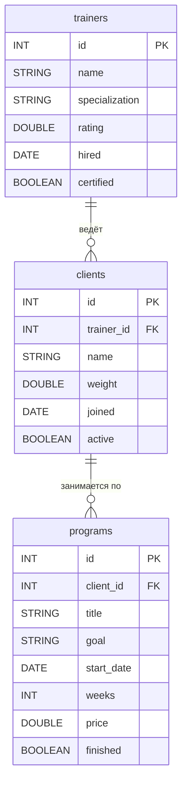
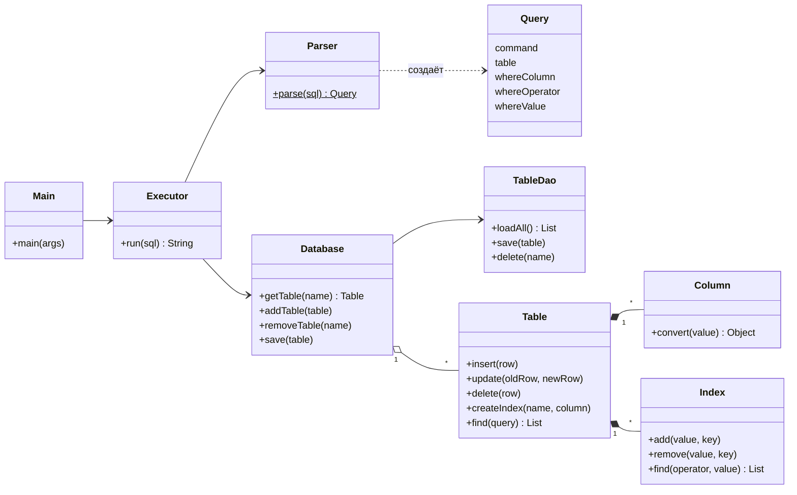
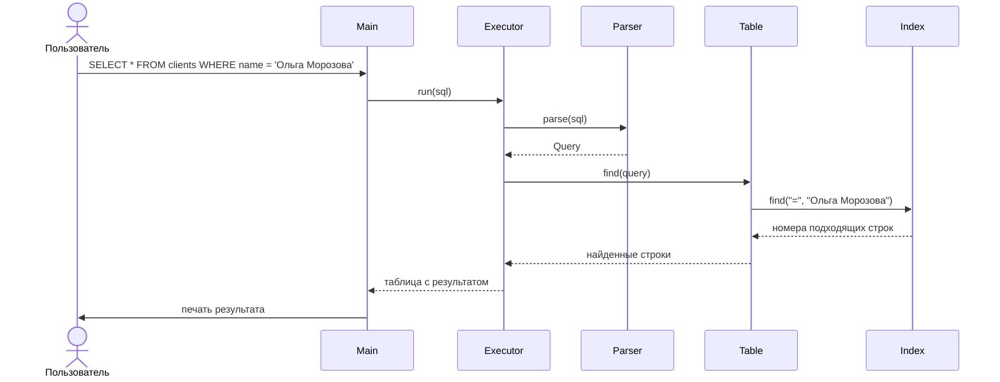
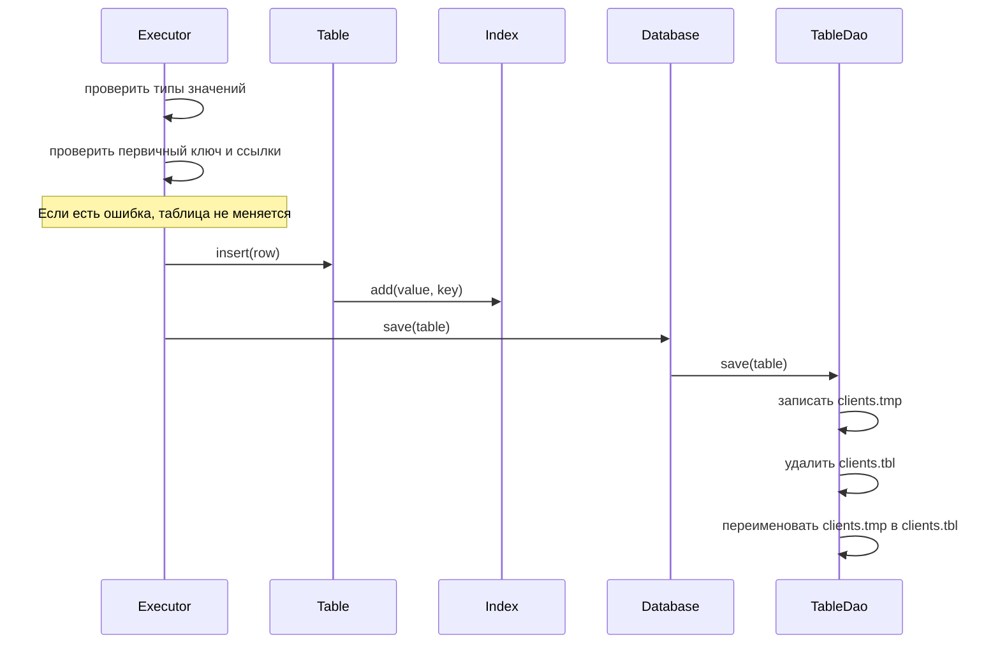

# GymDB — простая база данных на Java

Лабораторная работа 2. Мы написали маленькую базу данных. Она хранит таблицы в файлах на диске
и выполняет команды, похожие на SQL. Команды вводятся в консоли. Сторонние библиотеки не нужны,
программа работает на Java 8 и новее.

**Выполнили:** студенты группы 25КНТ-6 Лебедев Сергей Александрович и Копейкин Александр Александрович.

## Предметная область

Тренажёрный зал. В зале работают тренеры. У каждого тренера есть свои клиенты. Для каждого клиента тренер
составляет программы тренировок, например «Силовой старт» на 12 недель, чтобы набрать массу.

Базой пользуется администратор зала. Он может:

* записывать тренеров, клиентов и их программы;
* искать данные, например «все клиенты тренера Петрова» или «программы, которые ещё не закончены»;
* менять данные, например перевести клиента к другому тренеру;
* удалять ненужные записи.

В базе три таблицы.

**`trainers` — тренеры**

| Столбец | Тип | Что хранит |
|---|---|---|
| `id` | `INT`, первичный ключ | номер тренера |
| `name` | `STRING` | имя |
| `specialization` | `STRING` | направление: силовые, йога, кроссфит |
| `rating` | `DOUBLE` | рейтинг от 0 до 5 |
| `hired` | `DATE` | когда взяли на работу |
| `certified` | `BOOLEAN` | есть ли сертификат |

**`clients` — клиенты**

| Столбец | Тип | Что хранит |
|---|---|---|
| `id` | `INT`, первичный ключ | номер клиента |
| `trainer_id` | `INT`, ссылка на `trainers` | тренер клиента |
| `name` | `STRING` | имя |
| `weight` | `DOUBLE` | вес, кг |
| `joined` | `DATE` | когда пришёл в зал |
| `active` | `BOOLEAN` | действует ли абонемент |

**`programs` — программы тренировок**

| Столбец | Тип | Что хранит |
|---|---|---|
| `id` | `INT`, первичный ключ | номер программы |
| `client_id` | `INT`, ссылка на `clients` | чья программа |
| `title` | `STRING` | название |
| `goal` | `STRING` | цель: набор массы, похудение и т. д. |
| `start_date` | `DATE` | дата начала |
| `weeks` | `INT` | сколько недель длится |
| `price` | `DOUBLE` | цена, руб. |
| `finished` | `BOOLEAN` | закончена ли |

Таблицы связаны цепочкой: **тренер → клиенты → программы**. У одного тренера много клиентов,
у одного клиента много программ.

Ниже схема связей (ER-диаграмма). Такие диаграммы, как и остальные диаграммы в этом отчёте,
мы разбирали на курсе «Управление данными».



База следит, чтобы связи не ломались:

* нельзя записать клиента к тренеру, которого нет;
* нельзя создать программу для клиента, которого нет;
* нельзя удалить тренера, у которого есть клиенты, и клиента, у которого есть программы.

## Что умеет программа

| Что требует задание | Как сделано у нас |
|---|---|
| Таблицы, связанные по ключу | Три таблицы, связи через `REFERENCES` |
| Типы данных | целое `INT`, дробное `DOUBLE`, строка `STRING`, дата `DATE`, логическое `BOOLEAN` |
| Хранение на диске | Каждая таблица сохраняется в свой файл и загружается при запуске |
| Вставка с проверкой ключа | `INSERT` одной или нескольких строк. Если ключ повторяется, не вставляется ничего |
| Обновление и удаление | `UPDATE ... WHERE` и `DELETE ... WHERE` |
| Вывод таблицей | `SELECT` рисует таблицу в рамке |
| Команды | `SELECT`, `INSERT`, `UPDATE`, `DELETE`, `CREATE TABLE`, `DROP TABLE`, `CREATE INDEX` |
| Индексы | Сохраняются на диск и ускоряют поиск |
| Защита от сбоев | Если программа упадёт во время записи, данные не испортятся |

Что программа не умеет (по заданию это и не нужно):

* в `WHERE` только одно условие, например `price > 1000`;
* в `UPDATE` нельзя писать формулы вроде `price * 2`;
* первичный ключ нельзя изменить.

## Инструкция пользователя

**Как запустить.** Нужен JDK 8 или новее. Если `javac` нет в `PATH`, укажите путь к JDK в переменной `JAVA_HOME`.

* `build.bat` — собрать программу;
* `run.bat` — консоль, где вы сами пишете команды;
* `run.bat tests.sql` — выполнить все проверки из файла [tests.sql](tests.sql);
* `java -cp out Benchmark` — замер скорости.

В IntelliJ IDEA: пометьте папку `src` как Sources Root (правый клик → Mark Directory as → Sources Root) и запустите
класс `Main`. Чтобы выполнить проверки, в настройках запуска (Run → Edit Configurations) укажите в Program arguments
`tests.sql`, а в Working directory — папку проекта.

**Как писать команды.** Каждая команда заканчивается точкой с запятой `;`. Строки пишутся в одинарных
кавычках, даты — в виде `'2024-05-01'`. Выход из программы — `exit` или `выход`.

**Примеры команд:**

```sql
CREATE TABLE trainers (id INT PRIMARY KEY, name STRING, specialization STRING, rating DOUBLE, hired DATE, certified BOOLEAN);
CREATE TABLE clients (id INT PRIMARY KEY, trainer_id INT REFERENCES trainers(id), name STRING, weight DOUBLE, joined DATE, active BOOLEAN);

INSERT INTO trainers VALUES (1, 'Иван Петров', 'силовые', 4.8, '2021-09-01', TRUE);
INSERT INTO clients VALUES (1, 1, 'Дмитрий Орлов', 92.5, '2024-01-10', TRUE), (2, 1, 'Елена Волкова', 61.0, '2024-02-05', TRUE);

SELECT * FROM clients;
SELECT name FROM clients WHERE trainer_id = 1;
UPDATE clients SET weight = 90.0 WHERE id = 1;
DELETE FROM clients WHERE active = FALSE;

CREATE INDEX idx_clients_trainer ON clients (trainer_id);
SELECT name FROM clients WHERE trainer_id = 1;
DROP TABLE clients;
```

**Как это выглядит:**

```
gym> SELECT name FROM clients WHERE trainer_id = 1;
+---------------+
| name          |
+---------------+
| Дмитрий Орлов |
| Елена Волкова |
+---------------+
Строк: 2, поиск: индекс idx_clients_trainer
Время: 0,172 мс

gym> DELETE FROM trainers WHERE id = 1;
ОШИБКА: Строка с ключом 1 используется в таблице clients
```

Строка `поиск` показывает, как программа нашла строки: по первичному ключу, по индексу
или просмотром всей таблицы.

## Архитектура системы

Программа состоит из 10 классов:

| Класс | Что делает |
|---|---|
| `Main` | Читает команды из консоли или из файла и печатает ответ |
| `Parser` | Разбирает текст команды на части |
| `Query` | Хранит разобранную команду |
| `Executor` | Выполняет команду и рисует таблицу с результатом |
| `Database` | Хранит все таблицы и выдаёт их остальному коду |
| `TableDao` | Сохраняет таблицы в файлы, загружает их обратно и исправляет последствия сбоя |
| `Table` | Хранит строки таблицы и её индексы, ищет нужные строки |
| `Column` | Описывает столбец и проверяет, подходит ли значение по типу |
| `Index` | Индекс для быстрого поиска |
| `Benchmark` | Замеряет скорость поиска с индексом и без |

Паттерны проектирования:

* **Repository** — класс `Database`. Остальной код просит у него таблицы, как у обычной коллекции.
* **DAO** — класс `TableDao`. Вся работа с файлами собрана в нём, поэтому остальной код не знает, как таблицы лежат на диске.
* **Iterator** — класс `Table`. Строки таблицы можно перебрать обычным циклом `for (Object[] row : table)`.

### Диаграмма классов



### Диаграмма последовательности: поиск по индексу

Что происходит, когда пользователь ищет клиента по имени, а по столбцу `name` есть индекс:



### Диаграмма последовательности: добавление строки

Что происходит при `INSERT`:



### Как данные хранятся на диске

Каждая таблица вместе с её индексами сохраняется в отдельный файл `data/имя_таблицы.tbl`. Для этого
используется стандартная сериализация Java: объект таблицы целиком записывается в файл и потом читается обратно.

Чтобы данные не испортились при сбое, таблица сначала пишется во временный файл `.tmp`, и только потом
этот файл заменяет старый. При запуске программа проверяет, не осталось ли после сбоя лишних файлов:

| Что осталось в папке | Что это значит | Что делает программа |
|---|---|---|
| `.tmp` и `.tbl` | Программа упала, пока писала `.tmp` | Удаляет `.tmp`, старая версия цела |
| Только `.tmp` | Программа упала, когда `.tmp` уже был записан | Делает из `.tmp` основной файл |
| Испорченный `.tbl` | Файл повреждён | Откладывает его в `.bad`, остальные таблицы работают |

### Как работает индекс

Без индекса программа проверяет каждую строку таблицы подряд. Индекс — это отдельная структура
`TreeMap`, где значения столбца лежат по порядку, как слова в словаре. Поэтому нужное значение находится
сразу, без просмотра всей таблицы. Для условий `>`, `<`, `>=`, `<=` индекс сразу отдаёт нужный кусок
отсортированных значений.

Программа сама выбирает способ поиска:

1. условие `id = ...` по первичному ключу — сразу берёт строку по ключу;
2. условие по столбцу с индексом — ищет через индекс;
3. иначе — просматривает всю таблицу.

## Тестирование

### Проверочные запросы

Файл [tests.sql](tests.sql) по шагам проверяет все возможности программы: создание таблиц, все типы данных,
вставку, ошибки, поиск, изменение, удаление, индексы и связи между таблицами. Над каждым шагом написано,
что должно получиться.

### Скорость с индексом и без

Для замера мы создали таблицу `visits` и заполнили её случайными данными: 10 тысяч, 100 тысяч и миллион строк.
Каждый поиск повторяли 20 раз, ставили результаты по порядку и брали средний по счёту (медиану). Компьютер: Java 25, Windows 11.

**10 000 строк**

| Условие поиска | Найдено строк | Без индекса, мс | С индексом, мс |
|---|---:|---:|---:|
| `exercise = 'ex_500'` | 9 | 0,436 | 0,012 |
| `weight > 999` | 10 | 0,239 | 0,023 |
| `weight > 990` | 110 | 0,230 | 0,037 |
| `weight < 200` | 1 996 | 0,505 | 0,582 |

**100 000 строк**

| Условие поиска | Найдено строк | Без индекса, мс | С индексом, мс |
|---|---:|---:|---:|
| `exercise = 'ex_500'` | 108 | 1,798 | 0,007 |
| `weight > 999` | 90 | 1,121 | 0,010 |
| `weight > 990` | 965 | 1,274 | 0,046 |
| `weight < 200` | 20 024 | 1,639 | 2,276 |

**1 000 000 строк**

| Условие поиска | Найдено строк | Без индекса, мс | С индексом, мс |
|---|---:|---:|---:|
| `exercise = 'ex_500'` | 1 039 | 17,370 | 0,017 |
| `weight > 999` | 1 003 | 13,493 | 0,033 |
| `weight > 990` | 10 012 | 14,134 | 0,551 |
| `weight < 200` | 200 132 | 17,248 | 26,499 |

**Сколько стоит индекс**

| Действие | 10 000 строк | 100 000 строк | 1 000 000 строк |
|---|---:|---:|---:|
| Сохранить таблицу без индексов | 86 мс | 152 мс | 4 492 мс |
| Создать индекс по `exercise` | 40 мс | 188 мс | 5 323 мс |
| Создать индекс по `weight` | 54 мс | 337 мс | 7 610 мс |
| Загрузить таблицу с двумя индексами | 109 мс | 225 мс | 1 585 мс |
| Размер файла с двумя индексами | 1,0 МБ | 9,3 МБ | 81,2 МБ |

## Распределение работы в команде

| Участник | Что делал |
|---|---|
| Лебедев Сергей Александрович, 25КНТ-6 | `Parser`, `Query`, `Executor`, `Main`: разбор и выполнение команд, консоль |
| Копейкин Александр Александрович, 25КНТ-6 | `Database`, `TableDao`, `Table`, `Column`, `Index`, `Benchmark`: хранение, индексы, замеры, readme |

## Выводы

1. Мы сделали простую базу данных для тренажёрного зала: три связанные таблицы, пять типов данных, команды как в SQL и консоль для ввода.
2. Данные сохраняются в файлы и загружаются при запуске. Если программа упадёт во время записи, данные не пропадут.
3. Индекс сильно ускоряет поиск, когда нужно найти мало строк. На миллионе строк поиск стал быстрее в сотни раз.
4. Если нужно найти много строк (примерно пятую часть таблицы), индекс не помогает и даже немного замедляет поиск.
5. За индекс приходится платить: файл становится больше, а загрузка и изменения — медленнее.
6. Главный недостаток программы: после каждого изменения таблица сохраняется целиком. На больших таблицах это занимает несколько секунд.

## Список использованных источников

1. Лекции курса «Программирование на языке Java».
2. Лекции курса «Управление данными»: ER-диаграммы, диаграммы классов и последовательностей.
3. Java SE 8 API Documentation. — Oracle. — https://docs.oracle.com/javase/8/docs/api/
4. Java Object Serialization Specification. — Oracle. — https://docs.oracle.com/javase/8/docs/platform/serialization/spec/serialTOC.html
5. Кормен Т., Лейзерсон Ч., Ривест Р., Штайн К. Алгоритмы: построение и анализ. — Глава 13 «Красно-чёрные деревья».
